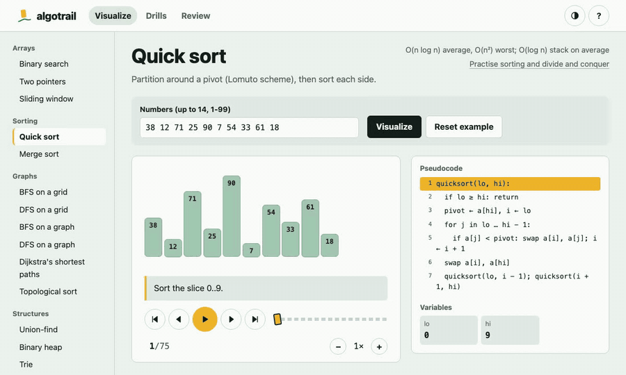
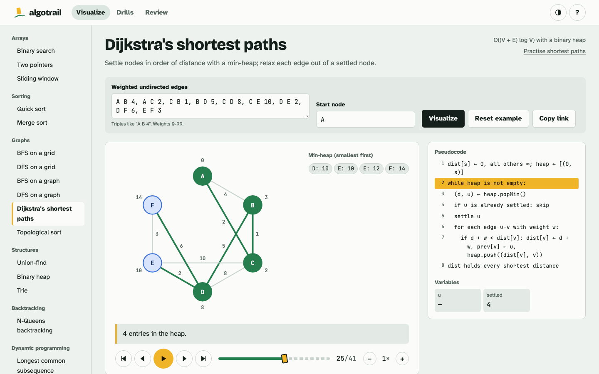
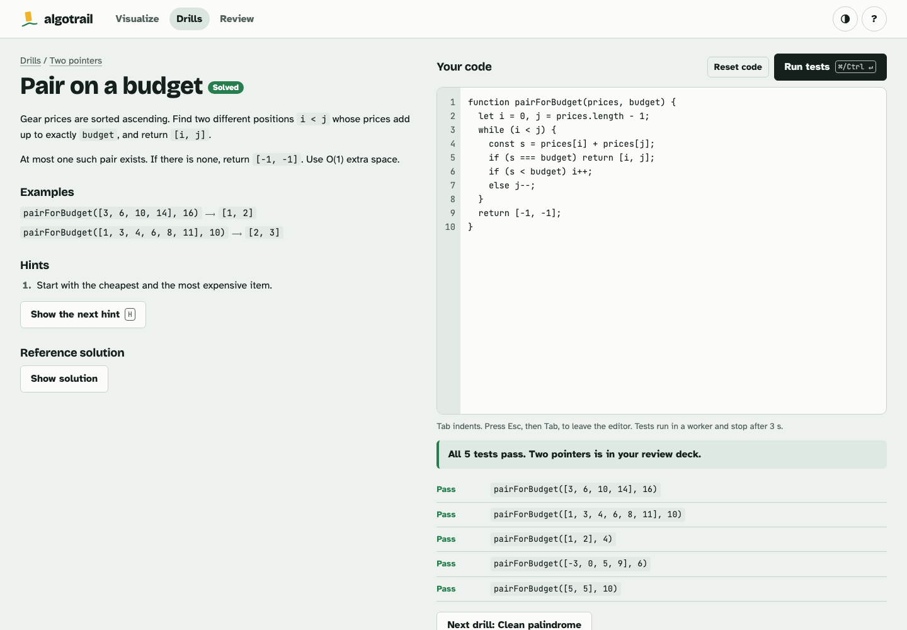
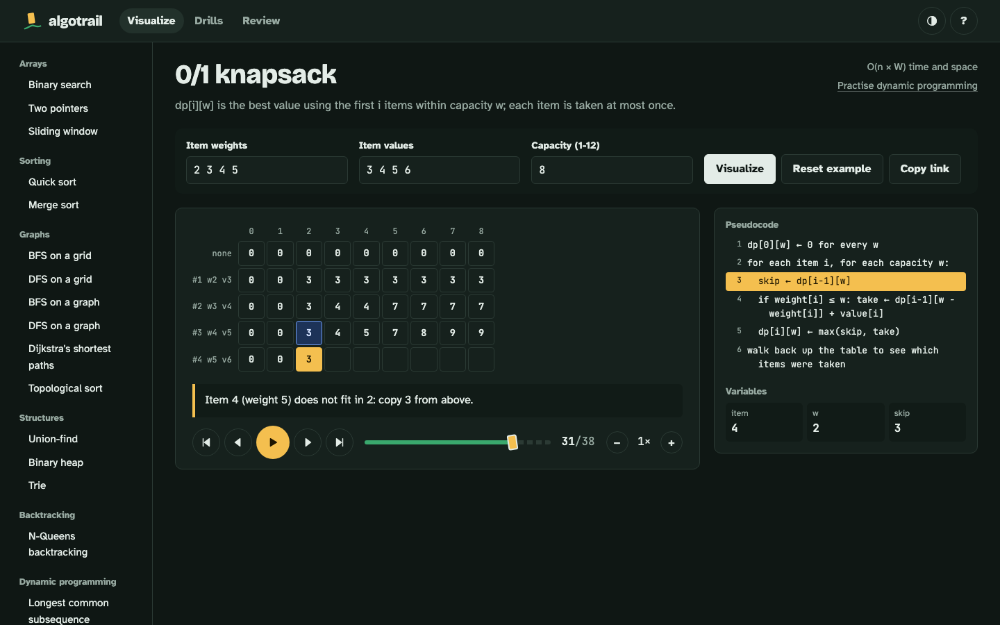
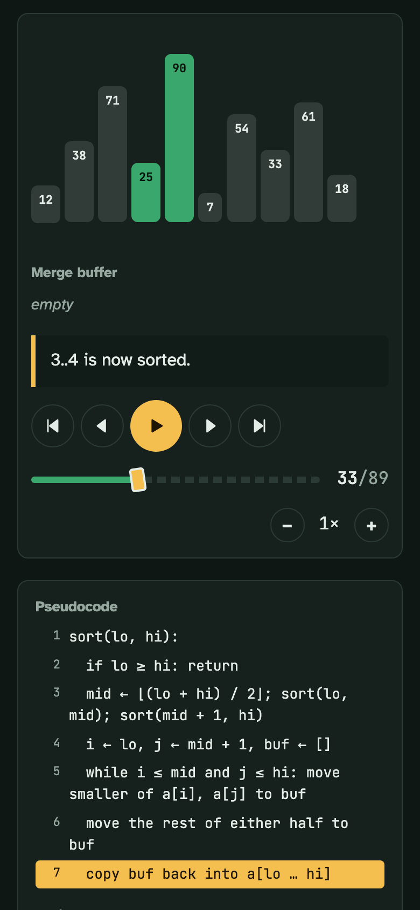

# algotrail

**Watch an algorithm run one pseudocode line at a time on your own input, then write it yourself and keep it with spaced review.**

Reading about Dijkstra is not the same as watching the heap settle each node, and watching is not the same as writing it yourself, so algotrail does all three in one place: 18 step-through visualizers, 43 original drills with tests that run in your browser, and a review deck of the patterns behind them. No account and no server; progress stays in your browser.



<sub>Recorded from the built app with `scripts/readme-demo.mjs`.</sub>

## Quickstart

There is no hosted copy yet, so run it locally. Needs Node.js 20.19 or newer (CI uses 22).

```sh
git clone https://github.com/Habibeyilmazz/algotrail.git
cd algotrail
npm ci
npm run dev        # open http://localhost:4200
```

Then press `V` for the visualizers, `D` for the drills, `R` for review, or `?` for every shortcut.

Other scripts:

```sh
npm test           # unit tests (vitest): algorithms, input fuzzing, every reference solution, runner, SM-2, storage
npm run typecheck  # tsc
npm run build      # static site in dist/
npm run e2e        # builds, then runs 21 user journeys in Playwright (Chromium) against dist/ on port 4202
                   # (first time only: npx playwright install chromium)
```

There is no backend. `dist/` is a static site that works from any folder, including GitHub Pages.

## Features



**Visualizer** for 18 algorithms: binary search, two pointers, sliding window, quick sort, merge sort, BFS and DFS on a grid, BFS and DFS on a graph, Dijkstra, topological sort (Kahn), union-find, binary heap, trie, N-Queens backtracking, longest common subsequence, 0/1 knapsack and coin change.

- Play, pause, step forward and back, jump to the start or end, scrub, and change speed (0.25× to 4×).
- The current pseudocode line is highlighted, the variables are listed, and every step has a one-line explanation.
- Every visualizer takes your own input: numbers, strings, edge lists, mazes drawn with `.#SE`, heap and union-find operation lists. Bad input gets a specific message, not a crash.
- Moving items (sort swaps, heap sift-up and sift-down) glide to their new place with GSAP. With `prefers-reduced-motion` they jump instead and colour transitions are off.

**Pattern drills**: 43 original short problems in 12 patterns (binary search, two pointers, sliding window, BFS/DFS, shortest paths, topological sort, union-find, heaps, sorting and divide and conquer, backtracking, dynamic programming, tries).

- Each drill has a three-step hint ladder, a JavaScript editor (Tab indents, Enter keeps the indent, Esc then Tab leaves it; no syntax highlighting), and tests.
- Tests run in a Web Worker. An infinite loop is stopped after 3 seconds and the page stays responsive. Failures show expected vs got, thrown errors and your `console.log` output.
- Each drill has a reference solution with its time and space complexity explained.

**Spaced review**: each pattern is one SM-2 card (signals, core idea, code template). Solving a drill adds its pattern to your deck; you can also add patterns by hand.

**Everything else**: light and dark themes (follows the system until you pick one), keyboard shortcuts for everything (press `?`), a phone layout, and progress saved in `localStorage` only. Drafts are saved shortly after you stop typing, when the editor loses focus, and when the tab is hidden or closed.

**Backups**: progress lives in one browser, so the footer has *Export a backup* (downloads `algotrail-backup-<date>.json` with solved drills, saved code, hints used, review schedule, theme and speed) and *Import a backup* (shows what the file holds and what this browser holds, then replaces this browser's progress after you confirm). Use it to move to another device or before clearing site data. Importing replaces; it does not merge.



<p>
  
  
</p>

## How it works

- **Algorithms produce frames.** Each visualizer (`src/algos/`) is a plain function from validated input to an array of frames. A frame holds the pseudocode line, a note, the variables and a list of panels (array, grid, graph, tree or list). The player only indexes into that array, so stepping back is free and every algorithm is unit-tested by checking its frames.
- **Input is a trust boundary.** Parsers in `src/algos/parse.ts` cap sizes (for example 16 numbers, 10 graph nodes, 10×14 mazes) and a run is limited to 1,500 frames so no input can freeze the tab.
- **Rendering.** React draws panels as HTML (arrays, tables) or SVG (graphs on a circle, trees with a small tidy layout). A FLIP hook measures keyed elements before and after each frame and tweens the difference with GSAP.
- **Drill runner.** `src/drills/runner.ts` compiles your code with `new Function` inside a module worker and deep-clones each test's arguments. The worker never sees the expected answers: it posts back the raw return value, and the page validates each message, compares the value structurally and clips long text, so code cannot fake a pass, crash the page or flood it. The page terminates the worker on timeout. A unit test runs every reference solution through the same runner, and checks that the empty starter fails.
- **Content-Security-Policy.** The build adds a CSP meta tag (`vite.config.ts`) that blocks inline and third-party scripts. It allows `'unsafe-eval'` because some browsers apply the page policy to the drill worker, which needs `new Function`.
- **Storage.** One `localStorage` key, rebuilt field by field on load so hand edits or old data cannot break the app. Other tabs stay in sync through the `storage` event. A backup file is the same data wrapped as `{ app: "algotrail", version: 1, exportedAt, progress }`; import refuses anything else, caps the size, and runs `progress` through the same sanitizer (`parseBackup` in `src/lib/store.ts`). Drafts are saved 0.4 s after typing stops, whenever the editor loses focus, and when the tab is hidden or closed (`pagehide`, `visibilitychange`); a draft of 50,000 characters or more is not saved (the drill page says so), so one huge paste cannot fill storage. If the browser refuses a save anyway, the footer says progress lasts only until the tab closes.

## Keyboard

| Keys | Action |
| --- | --- |
| `V` `D` `R` | Visualize, Drills, Review |
| `Space` or `K` | Play or pause |
| `←` `→` or `J` `L` | Step back or forward |
| `Home` `End` | First or last step |
| `-` `+` | Slower or faster |
| `H` | Next hint |
| `Ctrl/⌘ Enter` | Run tests, or apply visualizer input |
| `Space`, then `1`-`4` | Reveal a review card, then grade it |
| `T` | Switch theme |
| `?` | All shortcuts |

## Deploying

`.github/workflows/pages.yml` builds and deploys to GitHub Pages, but only when run by hand. Turn on Pages (Settings, Pages, Source: GitHub Actions) first.

## How it compares

algotrail is small on purpose. Well-known tools do more in their own lane; pick by what you need.

| If you want | Use | Why not algotrail |
| --- | --- | --- |
| Many more data structures and algorithms, with lecture-style notes and quizzes | [VisuAlgo](https://visualgo.net) | algotrail has 18 visualizers and no lectures. |
| Balanced trees and other structures (AVL, red-black, B-trees, hashing) | [Data Structure Visualizations](https://www.cs.usfca.edu/~galles/visualization/Algorithms.html) by David Galles | algotrail has no balanced trees or hash tables. |
| To visualize code you write yourself | [Algorithm Visualizer](https://github.com/algorithm-visualizer/algorithm-visualizer) | algotrail's visualizers run built-in algorithms on your input, not your code. |
| Hundreds of interview-style problems, many languages, discussions | [LeetCode](https://leetcode.com), [NeetCode](https://neetcode.io) | algotrail has 43 short drills, JavaScript only. |
| Flashcards for anything, with FSRS and sync | [Anki](https://apps.ankiweb.net) | algotrail's review is one SM-2 card per pattern, stored in one browser. |

Where algotrail fits: you are learning a pattern (two pointers, BFS, a DP table) and want to watch it on input you choose, write it yourself against tests a moment later, and be reminded to revisit it, all in one place, with no sign-up and nothing leaving your browser except the font request to Google Fonts.

## Status and roadmap

Working and tested: everything listed under Features. The unit tests (vitest) and the end-to-end suite (Playwright) run in CI on every push. Only Chromium has been tested end to end; Firefox and Safari have not.

Not built yet:

- Syntax highlighting in the drill editor.
- Visualizers for subsets backtracking, Bellman-Ford, prefix sums, monotonic stack and segment trees.
- A layered layout for directed graphs (topological sort uses the same circle layout as other graphs).
- Merging a backup into existing progress (import replaces it), and IndexedDB storage for larger histories.
- FSRS scheduling as an alternative to SM-2.
- Shareable links that carry visualizer input in the URL.
- A hosted copy on GitHub Pages (the workflow exists; Pages is not turned on).

## Contributing

New drills, visualizers and bug reports are welcome. [CONTRIBUTING.md](CONTRIBUTING.md) explains how both are built and tested, and asks that drills be written from scratch rather than copied from problem sites. Security problems: see [SECURITY.md](SECURITY.md).

## License

[MIT](LICENSE), copyright Habibeyilmazz.
